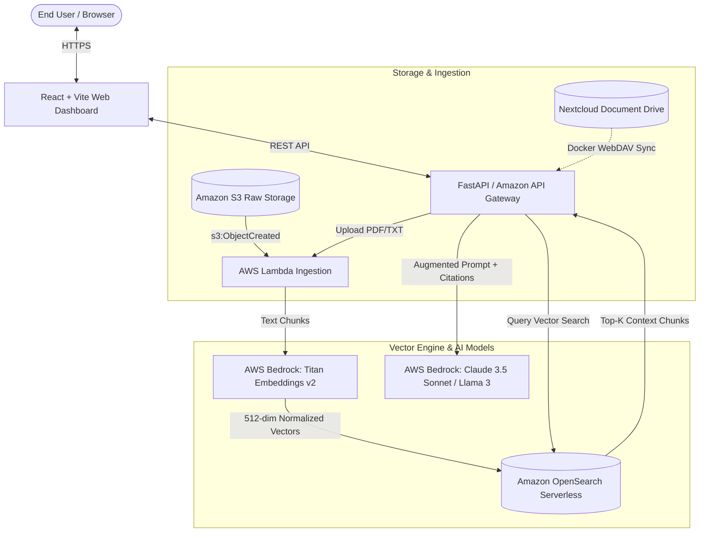

# DocuMind AI: Serverless Enterprise RAG Document Q&A Search Engine

[](https://aws.amazon.com/bedrock/)
[](https://aws.amazon.com/opensearch-service/features/serverless/)
[](https://www.docker.com/)
[](https://vitejs.dev/)

An enterprise-grade **Retrieval-Augmented Generation (RAG)** platform designed to ingest complex multi-page documents (PDFs, financial filings, technical whitepapers, SaaS MSAs) and deliver verifiable, grounded answers with exact source chunk and page citations.

---

## 🏗️ Architecture & Component Overview



---

## 🚀 Key Features

1. **Enterprise Grounding & Anti-Hallucination**:
   - Every claim is anchored with a source citation `[Chunk: <id>, Page: <page>]`.
   - Context Chunk Inspector allows one-click auditing of the exact chunk text, cosine similarity %, and document origin.
2. **Dual-Mode Portability**:
   - **Local Dev / Simulation Mode**: Instant testing with zero AWS cost or credentials using built-in deterministic semantic vector hashing and local synthesis.
   - **AWS Cloud Live Mode**: Seamless switch to AWS Bedrock (`amazon.titan-embed-text-v2:0` & `anthropic.claude-3-5-sonnet-20240620-v1:0`), Amazon OpenSearch Serverless, and Amazon S3.
3. **Docker & Nextcloud Private Cloud Integration**:
   - Runs self-hosted **Nextcloud** alongside **MariaDB**, **FastAPI Backend**, and **React Frontend** using `docker-compose.yml`.
   - One-click Nextcloud sync pulls documents directly from private enterprise storage into the vector search engine.
4. **Infrastructure as Code (AWS CDK)**:
   - Complete TypeScript CDK stack in `infra/` provisioning S3 buckets, OpenSearch Serverless collection, IAM least-privilege roles, Lambda functions, and API Gateway.

---

## 🐳 Running with Docker & Nextcloud

To launch the complete containerized stack (Nextcloud storage + MariaDB + DocuMind RAG Backend + Frontend):

```bash
docker compose up -d
```

### Container Endpoints:
- **DocuMind Web Dashboard**: [http://localhost:5173](http://localhost:5173)
- **RAG FastAPI Backend & Swagger Docs**: [http://localhost:8000/docs](http://localhost:8000/docs)
- **Nextcloud Document Repository**: [http://localhost:8080](http://localhost:8080)
  - Default User: `admin`
  - Default Password: `admin123`

---

## 💻 Running Locally (Without Docker)

### 1. Start Backend API Server
```bash
# Activate virtual environment
.venv\Scripts\activate   # Windows
# or source .venv/bin/activate # Linux/macOS

# Launch FastAPI
python -m uvicorn backend.main:app --host 127.0.0.1 --port 8000 --reload
```

### 2. Start React Web Dashboard
```bash
cd frontend
npm install
npm run dev
```
Open [http://localhost:5173](http://localhost:5173) in your browser.

---

## ☁️ Deploying to AWS (AWS CDK)

Ensure you have your AWS credentials configured (`aws configure`):

```bash
cd infra
npm install
npx cdk bootstrap
npx cdk deploy
```

This provisions:
- **Amazon S3**: `DocuMindDocumentBucket` with KMS encryption and event notifications.
- **Amazon OpenSearch Serverless**: `documind-vectors` vector collection with HNSW cosine similarity index.
- **AWS Lambda**: `DocuMindIngestFunction` and `DocuMindQueryFunction`.
- **Amazon API Gateway**: REST API with CORS and proxy routes.

---

## 📄 Preloaded Sample Documents
The application includes preloaded enterprise documents for immediate testing:
- **`aws_genai_rag_architecture.txt`**: Architectural breakdown of Bedrock Titan v2, chunking, and OpenSearch Serverless.
- **`q4_enterprise_financial_report.txt`**: Meridian Cloud Technologies financial filings (revenue, EBITDA margin, AI CAPEX).
- **`saas_master_services_agreement.txt`**: SaaS contract with 99.95% SLA, service credits, and AI training exclusion terms.

Click **Load Samples** in the top navigation bar to index them instantly!
